# CodAdapt benchmarks

The [benchmark suite](README.md) contains all 97 valid measurements, 83 completed paired comparisons and one missing result across 14 development origins. Six fixed baseline configurations are retained. Competitive results refer to CodAdapt 2.1.0; the 2.2.0 technical measurements are separate. No fresh competitive measurements, formal equivalence, or independent Pareto certification are claimed.

## Predictive performance

| Dataset / baseline | Metric | CodAdapt 2.1.0 | Baseline |
|---|---|---:|---:|
| Breast Cancer Wisconsin / Logistic regression | ROC-AUC ↑ | **0.989778** | 0.989194 |
| Danish occupancy / Random Forest | ROC-AUC ↑ | **0.939468** | 0.901309 |
| Concrete / Ridge | RMSE ↓ | **7.670131** | 11.241282 |
| Edge task execution times / Random Forest | RMSE ↓ | **0.081945** | 0.180472 |
| Pen Digits / CatBoost | Balanced accuracy ↑ | 0.927756 | **0.994546** |
| NYC Reservoir / Ridge | RMSE ↓ | 2.861377 | **0.941486** |

Bold identifies numerical observations, not confirmed statistical superiority. The full panel includes 14 exploratory favorable, 40 inconclusive and 29 exploratory unfavorable comparisons; one Glass/XGBoost comparison is missing. No primary comparison demonstrated superiority after the original Holm correction.

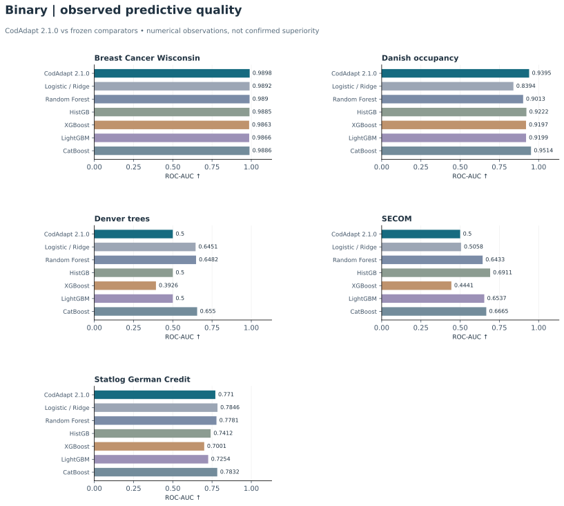
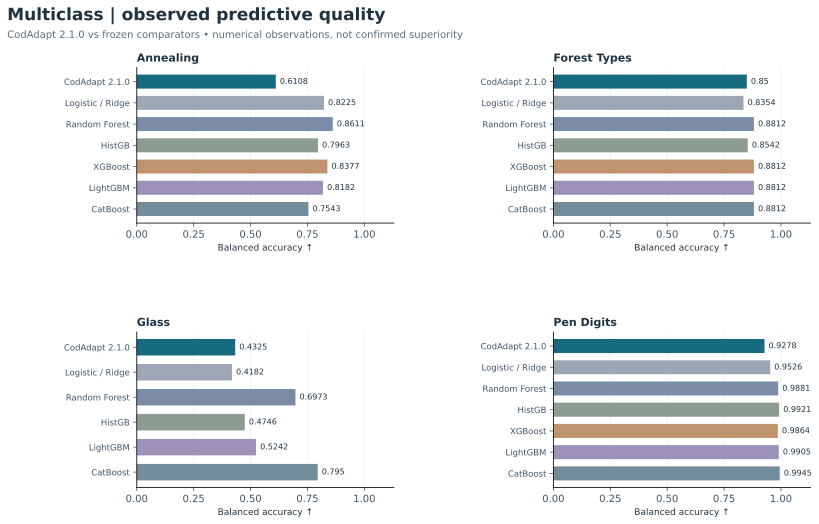
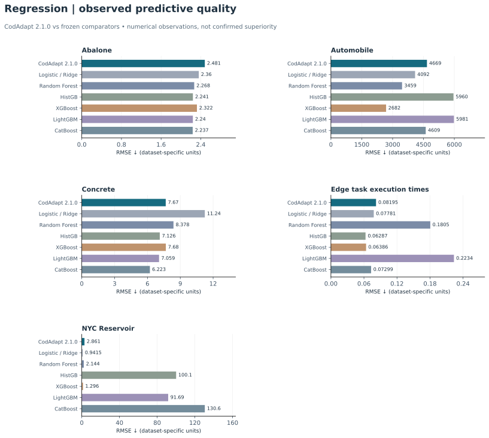

## Computational efficiency

Selected paired observations (percentage reductions relative to the baseline; the full tables retain all results):

| Dataset / baseline | Loss | Fit + prep | Single-row latency | Batch latency | Peak training RSS | Model bytes | Load |
|---|---:|---:|---:|---:|---:|---:|---:|
| Danish occupancy / Random Forest | 39.98% | 83.34% | 88.14% | 92.27% | 10.15% | 99.02% | 91.78% |
| Concrete / Random Forest | 8.45% | 70.01% | 92.76% | 91.69% | 9.98% | 99.05% | 92.24% |
| Edge task execution times / Random Forest | 54.59% | 87.51% | 92.64% | 94.57% | 20.17% | 99.91% | 97.55% |

Loss is logloss for classification and RMSE for regression. The ratios refer to paired 2.1.0 development workloads; the RSS measure includes process overhead, and loading is not certified cold-cache. A smaller serialized model does not imply lower loaded RAM.

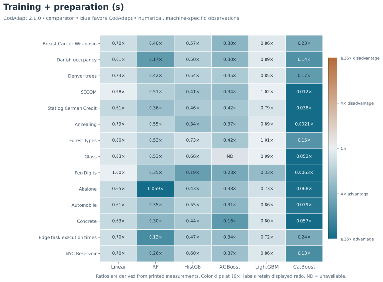
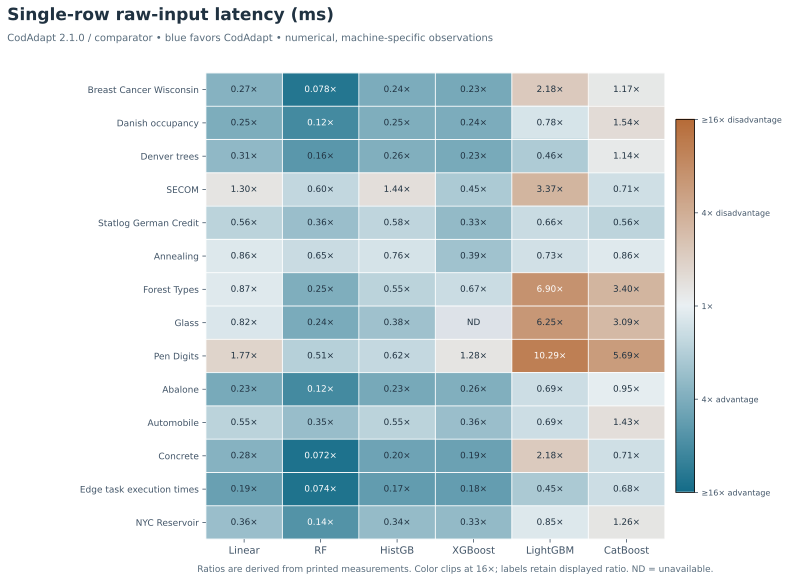
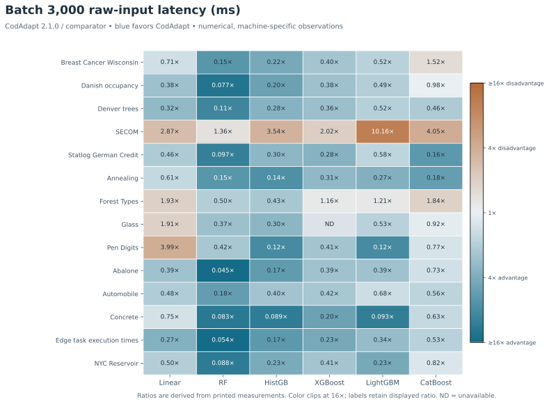
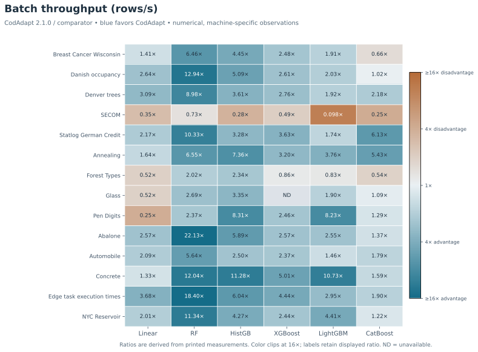
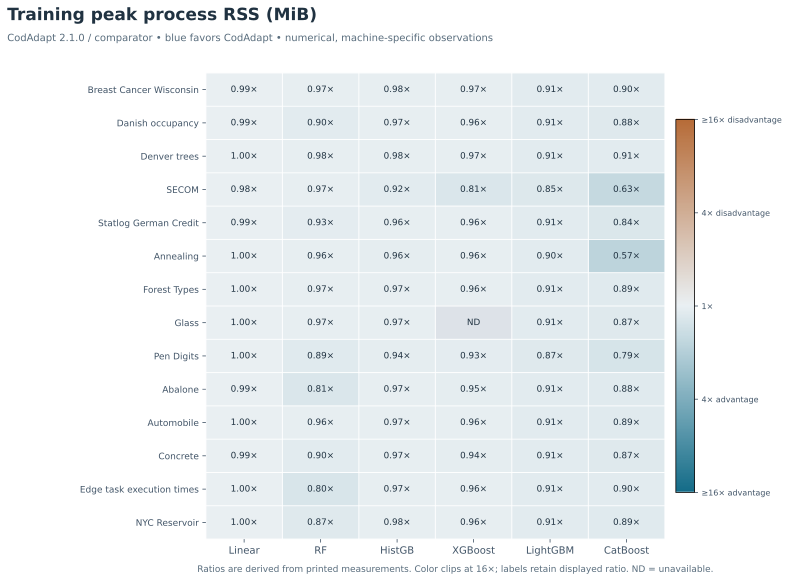
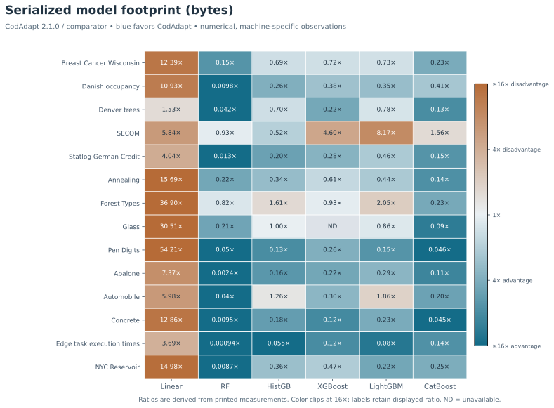
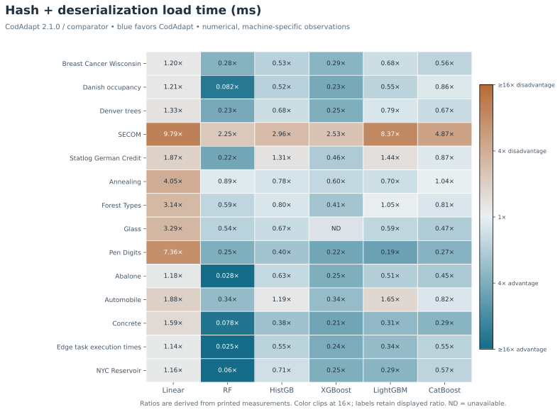

## Performance–efficiency trade-offs

Fifteen pointwise observations on six origins meet the loss/byte screen and have no higher observed costs on the five other measured cost endpoints. This is development evidence, not independent Pareto certification. The original operating thresholds and class recall must also be checked: Danish occupancy has a native FPR of about 6.30%, above the 0.5% requirement where applicable.

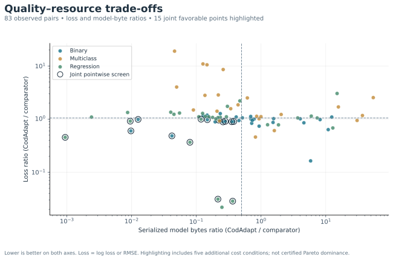

## Technical improvements in 2.2.0

The separate technical measurements cover combined classifier outputs, prepared-input reuse, compression and the separately measured serving/trace companion. Combined output is faster than three separate calls in the tested classifier workloads, but is close to parity against an efficient fused path. Regression, preparation overhead, memory and loading trade-offs are reported in the [technical evidence](TECHNICAL.md). The compatibility revision does not inherit fresh timing measurements.

## Methodology and complete results

Read the [methodology](METHODOLOGY.md), [all dataset results](RESULTS.md), [all paired comparisons](COMPARISONS.md), [figures and data](README.md), [historical 2.1.0 panel](HISTORICAL_210.md) and [applicability guide](../docs/PERFORMANCE.md). The numerical tables are a transcription of the supplied report at its displayed precision, with [full-precision aggregate measurements](data/full_precision.json) supplied separately. No new fit or measurement was generated.

## Additional comparative and technical detail

### Full comparative overview

The [benchmark suite](https://github.com/lucalullo/codadapt/tree/main/benchmarks)
contains complete per-dataset and per-algorithm measurements, figures,
machine-readable data, methodology, and statistical limitations.

Two bodies of evidence are reported separately:

- **Comparative performance:** CodAdapt 2.1.0 against six fixed baseline
  configurations on 14 development datasets. The panel contains 97 valid
  estimator/dataset measurements, 83 completed paired comparisons, and one missing
  comparison. Baselines are logistic regression or ridge, Random Forest,
  histogram gradient boosting, XGBoost, LightGBM, and CatBoost.
- **Technical performance:** version 2.2.0 against the corresponding 2.1.0
  implementation, including combined outputs, prepared inputs, and compression.
  These are not fresh competitive training or inference measurements against the
  six external baselines.

### Predictive performance

The table reports the primary metric for every development dataset, together
with the numerically best measured external baseline. ROC-AUC and balanced
accuracy (BA) are higher-is-better metrics; RMSE is lower-is-better. Bold values
identify the better numerical observation in each row, not statistical significance.

| Dataset | Metric | CodAdapt 2.1.0 | Best measured baseline | Baseline value |
|---|---|---:|---|---:|
| Breast Cancer Wisconsin | ROC-AUC ↑ | **0.989778** | Logistic regression | 0.989194 |
| Danish occupancy | ROC-AUC ↑ | 0.939468 | CatBoost | **0.951437** |
| Denver trees | ROC-AUC ↑ | 0.500000 | CatBoost | **0.655039** |
| SECOM | ROC-AUC ↑ | 0.500000 | Histogram gradient boosting | **0.691078** |
| Statlog German Credit | ROC-AUC ↑ | 0.770989 | Logistic regression | **0.784626** |
| Annealing | BA ↑ | 0.610802 | Random Forest | **0.861111** |
| Forest Types | BA ↑ | 0.850000 | RF / XGBoost / LightGBM / CatBoost | **0.881250** |
| Glass | BA ↑ | 0.432456 | CatBoost | **0.794956** |
| Pen Digits | BA ↑ | 0.927756 | CatBoost | **0.994546** |
| Abalone | RMSE ↓ | 2.481442 | CatBoost | **2.237011** |
| Automobile | RMSE ↓ | 4668.945963 | XGBoost | **2682.098217** |
| Concrete | RMSE ↓ | 7.670131 | CatBoost | **6.222557** |
| Edge task execution times | RMSE ↓ | 0.081945 | Histogram gradient boosting | **0.062866** |
| NYC Reservoir | RMSE ↓ | 2.861377 | Ridge | **0.941486** |

The observed primary-metric outcomes under the original exploratory comparison
rules are:

| Task | Favorable | Inconclusive | Unfavorable | Missing |
|---|---:|---:|---:|---:|
| Binary classification | 6 | 23 | 1 | 0 |
| Multiclass classification | 0 | 9 | 14 | 1 |
| Regression | 8 | 8 | 14 | 0 |
| **Total** | **14** | **40** | **29** | **1** |

No primary-metric superiority was confirmed after the original Holm correction.
Inconclusive results do not establish equivalence. The datasets were previously
used in development, so these observations are not independent confirmation.

[All predictive metrics, including accuracy, AUC, logloss, RMSE, MAE and class recall](https://github.com/lucalullo/codadapt/blob/main/benchmarks/RESULTS.md)

### Performance and resource efficiency

The following selected comparisons illustrate workloads in which CodAdapt has
both a favorable loss observation and lower measured computational costs.
Each entry reports the percentage reduction relative to the indicated baseline.
The complete suite retains unfavorable observations and all other measured cases.

| Dataset / baseline | Loss | Fit + preprocessing | Single-row latency | Batch latency (3,000) | Peak training RSS | Model bytes | Loading time |
|---|---:|---:|---:|---:|---:|---:|---:|
| Danish occupancy / Random Forest | 39.98% | 83.34% | 88.14% | 92.27% | 10.15% | 99.02% | 91.78% |
| Concrete / Random Forest | 8.45% | 70.01% | 92.76% | 91.69% | 9.98% | 99.05% | 92.24% |
| Concrete / XGBoost | 0.13% | 83.76% | 80.63% | 80.05% | 5.62% | 88.17% | 78.64% |
| Edge task execution times / Random Forest | 54.59% | 87.51% | 92.64% | 94.57% | 20.17% | 99.91% | 97.55% |
| Statlog German Credit / XGBoost | 9.03% | 58.02% | 67.45% | 72.48% | 3.70% | 71.93% | 53.84% |

Loss is logloss for classification and RMSE for regression. These are historical
2.1.0 measurements on the same paired workloads, not newly measured 2.2.0
speedups. RSS includes process overhead, and loading is not a certified cold-disk
measurement. The percentages are point estimates, not confidence bounds.

Across the full panel, **15 comparisons on six datasets** satisfy a pointwise
loss ratio of at most 1.05, a serialized-byte ratio of at most 0.50, and no
increase in any of the five other measured costs (training, single-row inference,
batch inference, peak training RSS, and loading). These are observed
quality-resource trade-offs, not statistically established Pareto dominance.

For example, CodAdapt records ROC-AUC 0.939468 versus 0.901309 for Random Forest
on Danish occupancy. On Edge task execution times, its RMSE is 0.081945 versus
0.180472 for Random Forest. Conversely, CatBoost produces lower RMSE on Concrete
and substantially higher balanced accuracy on Pen Digits. A favorable AUC does
not establish suitability at a required false-positive rate: the recorded native
threshold on Danish occupancy has FPR approximately 6.30%, above the 0.5%
requirement in protocols that use that limit.

[All paired comparisons and quality-resource observations](https://github.com/lucalullo/codadapt/blob/main/benchmarks/COMPARISONS.md)

[Quality-resource figure](https://github.com/lucalullo/codadapt/blob/main/benchmarks/figures/quality_resource.svg)
· [Training](https://github.com/lucalullo/codadapt/blob/main/benchmarks/figures/fit_prep_s.svg)
· [Single-row inference](https://github.com/lucalullo/codadapt/blob/main/benchmarks/figures/b1_ms.svg)
· [Throughput](https://github.com/lucalullo/codadapt/blob/main/benchmarks/figures/rows_per_s.svg)
· [Memory](https://github.com/lucalullo/codadapt/blob/main/benchmarks/figures/train_rss_mib.svg)
· [Model size](https://github.com/lucalullo/codadapt/blob/main/benchmarks/figures/model_bytes.svg)
· [Loading](https://github.com/lucalullo/codadapt/blob/main/benchmarks/figures/load_ms.svg)

### What's new in 2.2.0: technical performance

| Measurement | Observed result | Scope |
|---|---|---|
| Combined classifier outputs | 65.0-66.5% less elapsed time | Relative to three separate 2.1.0 calls; three tested batch sizes |
| Combined versus efficient fused evaluation | Approximately 0.995-1.036 times elapsed time | Classification fixtures; no general acceleration over an already fused path |
| Prepared-input requests | 15.7-57.3% of the corresponding fused elapsed time | Nine measured cases; excludes session preparation and retained model/input memory |
| Optional snapshot compression | Median file-size reduction of 74.4-77.5%, depending on task | Fourteen archived models; loaded RAM is not inferred from file size |
| Prediction compatibility | Exact outputs in the earlier verified replay contracts | Fourteen archived models; 9,883 examples; not rerun after the codec revision |

Regression combined requests can add overhead; use `predict` when only the
regression output is needed. Prepared inputs are useful when repeated requests
amortize the initial preparation and model-copy costs. Compressed snapshots may
load more slowly. The standalone lightweight serving and trace companion was
measured separately and is not bundled in this source distribution.

[Technical measurements and compression results](https://github.com/lucalullo/codadapt/blob/main/benchmarks/TECHNICAL.md)

### Methodology and reproducibility

The comparative panel uses fixed splits and baseline configurations, a common
host and one numerical thread. It is not an exhaustive hyperparameter search.
Complete quality, training, inference, throughput, memory, serialized-size and
loading observations are available in the benchmark tables. The accompanying
CSV files and plotting script reproduce the figures from the recorded values.
Independent validation on new origins remains incomplete.

- [Benchmark overview](https://github.com/lucalullo/codadapt/blob/main/BENCHMARKS.md)
- [Methodology](https://github.com/lucalullo/codadapt/blob/main/benchmarks/METHODOLOGY.md)
- [Complete results](https://github.com/lucalullo/codadapt/blob/main/benchmarks/RESULTS.md)
- [Paired comparisons](https://github.com/lucalullo/codadapt/blob/main/benchmarks/COMPARISONS.md)
- [Figures and numerical data](https://github.com/lucalullo/codadapt/tree/main/benchmarks)
- [Historical 2.1.0 benchmarks](https://github.com/lucalullo/codadapt/blob/main/benchmarks/HISTORICAL_210.md)

