# Detailed figures and numerical data

**Development evidence — CodAdapt 2.1.0 vs fixed baselines; separate 2.2.0 technical checks.**

The benchmark suite records all 97 valid estimator/dataset measurements, 83 paired comparisons and one missing result across 14 origins. No fresh training, new timing or independent confirmation was performed in this documentation revision. The repository contains the complete numerical transcription at the report’s printed precision, with its source digest and rounding boundaries recorded in the provenance file.

| Report | Contents |
|---|---|
| [Results by dataset](RESULTS.md) | All quality, timing, throughput, memory, size and recall tables |
| [Paired comparisons](COMPARISONS.md) | Every outcome, interval, numerical direction, missing result and all 15 joint points |
| [Technical performance](TECHNICAL.md) | 2.2.0 implementation, compression, reuse and separate serving/trace observations |
| [Methodology](METHODOLOGY.md) | Scope, metrics, experimental limitations and plotting instructions |
| [Historical 2.1.0 panel](HISTORICAL_210.md) | Separate three-origin published measurements |
| [Source data](data/) | CSV tables and source provenance |

## Predictive performance

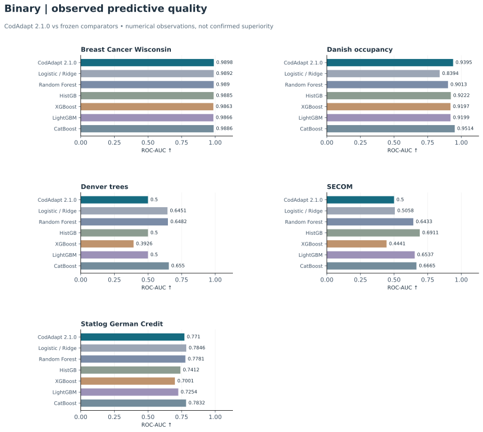

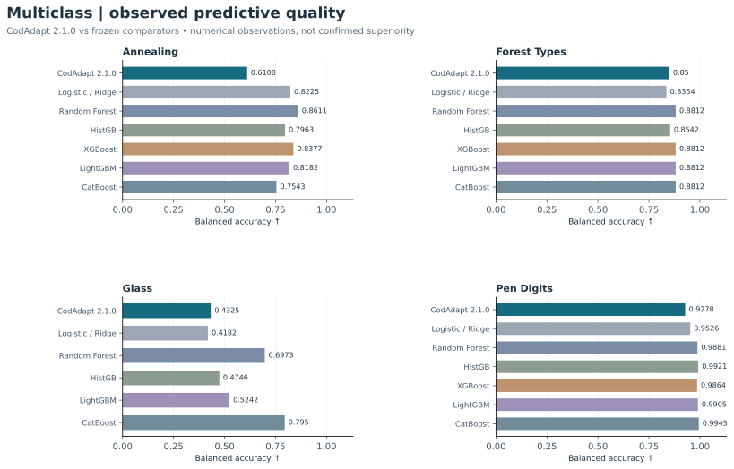

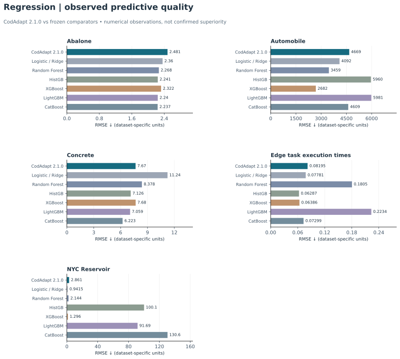

## Computational efficiency

All heatmaps show the CodAdapt 2.1.0 / comparator ratio, derived from displayed values. Below one is lower cost for the five cost metrics; above one is higher throughput for the throughput plot. ND is unavailable.

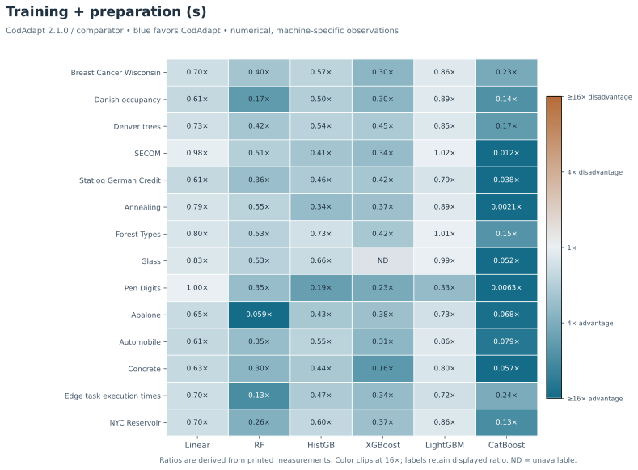

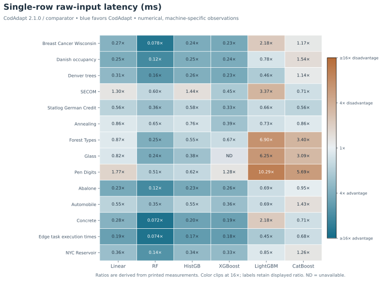

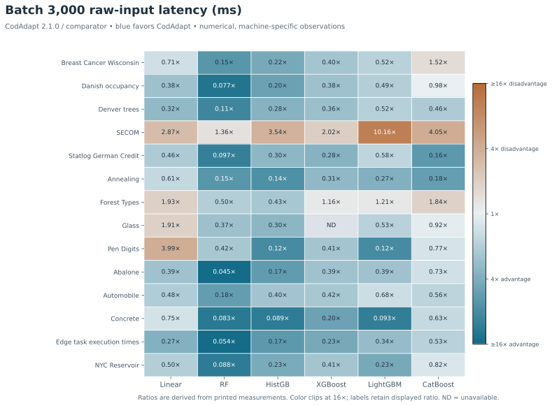

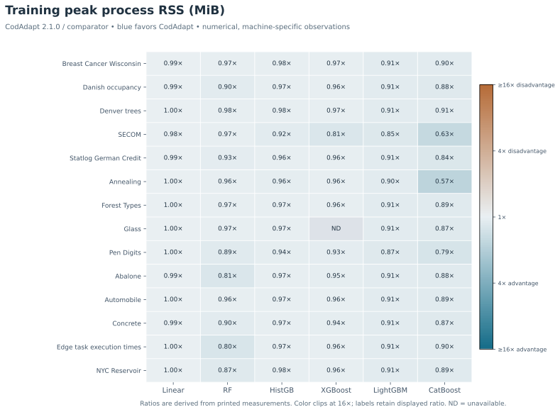

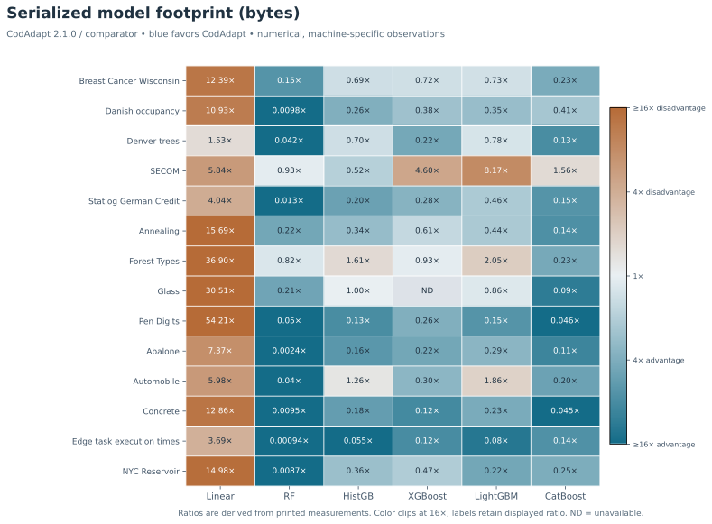

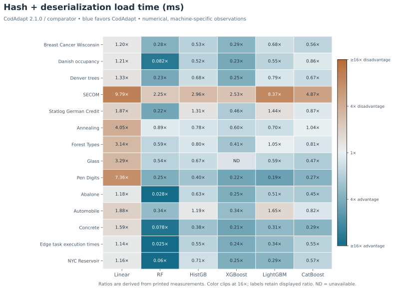

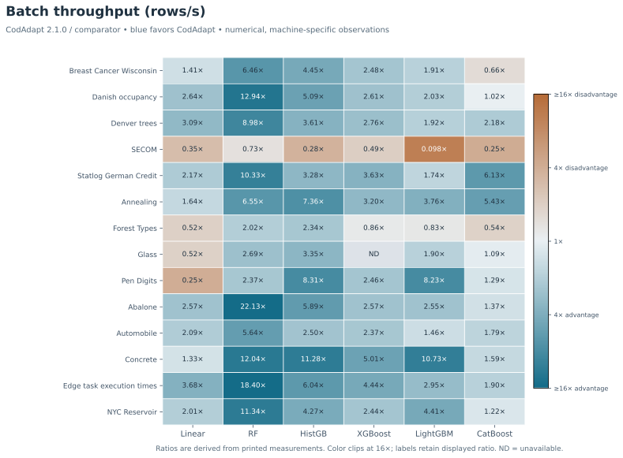

## Quality–resource trade-offs

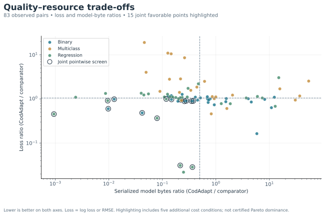

The 15 highlighted pointwise comparisons occur on six origins; the screen is not independent Pareto certification. Read the operating limitations, especially recall and FPR, before choosing an estimator. [Applicability guide](../docs/PERFORMANCE.md).

## Machine-readable data

- [Full measurements](data/measurements.csv), [dataset inventory](data/datasets.csv), [per-class recall](data/class_recall.csv).
- [All paired comparisons](data/paired_comparisons.csv), [15 joint points](data/joint_tradeoffs.csv).
- [Technical paths](data/technical_paths.csv), [compression](data/compression.csv), [reuse setup](data/reuse_setup.csv), [serving/trace](data/serving_trace.csv), [serving batches](data/serving_batches.csv).
- [Provenance](data/provenance.json); [plotting script](plot_results.py).

Aggregate measurements and figures are provided for transparent comparison. No dataset rows, protected targets, model artifacts from real datasets or private research records are distributed.

## Original aggregate precision

[Full-precision aggregate measurements](data/full_precision.json) preserve all 97 records from the authenticated source. An audit checked 1,358 displayed quality/cost values against those records without a mismatch beyond rounding. The printed-precision tables and figures remain unchanged. Dataset rows, labels and trained benchmark models are not included.
