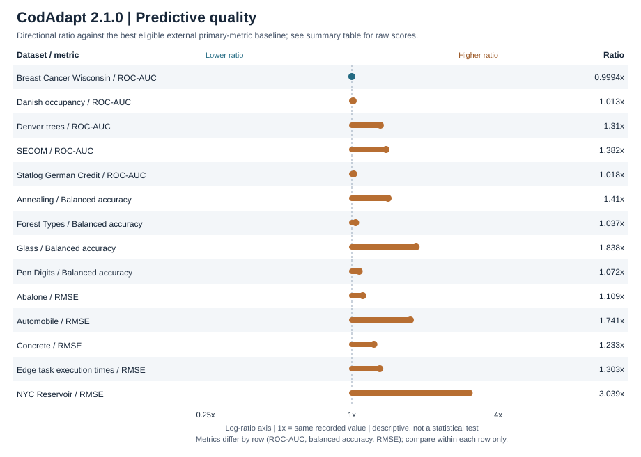
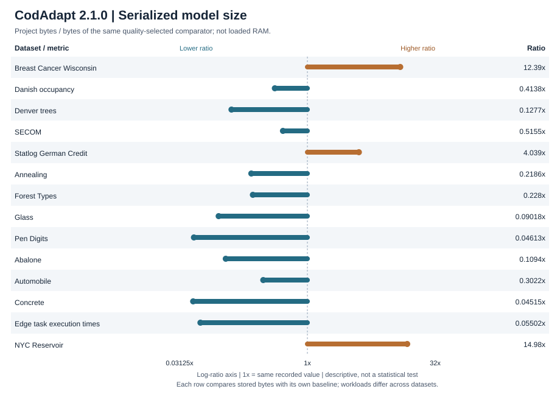

# CodAdapt benchmarks

**Competitive evidence: CodAdapt 2.1.0 development panel; separate 2.2.0 technical checks.**

## Scope and coverage

| Item | Recorded scope |
|---|---|
| Evaluated release | 2.1.0 competitive; 2.2.0 technical evidence separate |
| Comparators | Logistic/Ridge, Random Forest, HistGradientBoosting, XGBoost, LightGBM, CatBoost |
| Dataset origins | 14 development origins |
| Regime | Fixed configurations and splits, one numerical thread |
| Final jobs | 97 measured / 98 attempted; 83 completed pairs, one missing |
| Reproducibility | Per-origin documentation, aggregate audit and chart regeneration; historical fold replay from authenticated original assets |

## Predictive performance

The common overview compares CodAdapt 2.1.0 with the numerically best available external baseline on each dataset's primary metric (ROC-AUC for binary, balanced accuracy for multiclass, RMSE for regression). The missing Glass/XGBoost comparison stays missing. The original exploratory comparisons and intervals are retained separately.

*Rows use different predictive metrics (ROC-AUC, balanced accuracy, RMSE). Compare CodAdapt with its comparator within each row only; the bar lengths are not a cross-task ranking.*

[Summary table](overview/SUMMARY.md) · [Complete results](RESULTS.md) · [Paired comparisons](COMPARISONS.md)

## Computational efficiency

Size is the serialized model, not process RAM or installation size. The summary table compares fit plus preparation, peak training RSS and stored bytes with the same quality-selected comparator. Historical timing and resource metrics retain their original definitions and caveats.

[Measurement definitions](METHODOLOGY.md) · [Detailed figures](FIGURES.md) · [2.2.0 technical checks](TECHNICAL.md)

## Quality-resource trade-offs

Fifteen pointwise observations on six origins meet the original loss/byte screen and five additional cost limits; these are not independent Pareto certification. Stronger baseline scores on multiclass and regression tasks and native-threshold FPR constraints remain visible. [Applicability guide](../docs/PERFORMANCE.md) · [Development panel](DEVELOPMENT_PANEL.md).

## Methodology and reproducibility

The [methodology](METHODOLOGY.md) records the source, metrics, operating thresholds and statistical boundaries. The [reproducibility matrix](REPRODUCE.md) identifies each original source, the evidence level, the commands that can be run and the missing artifacts. Original 14-origin refits are not reconstructible from the supplied aggregate records alone; the separate historical three-origin replay has authenticated fold manifests and a runnable recipe. `python benchmarks/plot_overview.py` reads the included aggregate CSV only. `python benchmarks/plot_results.py` recreates the original detailed figures from the recorded values; it does not train or score models. [Provenance](data/provenance.json) and [full-precision data](data/full_precision.json) preserve source custody.

## Evidence roadmap

Independent confirmation and a preregistered Pareto evaluation are future research objectives, not completed or scheduled results. The proposed evaluation retains at least 20 independently certified origins, a relative loss margin of 5% and a maximum byte ratio of 50%. The required origin certification and execution authorization are not complete; no date or successful outcome is promised.

## Complete results and figures

| Report | Contents |
|---|---|
| [Complete results](RESULTS.md) | All quality, timing, throughput, memory, size and recall metrics |
| [Paired comparisons](COMPARISONS.md) | Original outcome labels, intervals, missing pair and all 15 joint points |
| [Detailed figures](FIGURES.md) | Original SVG plots and numerical data |
| [Numerical data](data/) | CSV tables, full precision JSON and provenance |
| [Historical evidence](HISTORICAL_210.md) | Separate three-origin published measurements |
| [Technical performance](TECHNICAL.md) | 2.2.0 implementation, compression, reuse and serving/trace observations |

## Limitations

The development panel is not independent confirmation. No primary superiority was confirmed after the original Holm correction; inconclusive results do not imply equivalence. Raw dataset rows, protected targets, real-data model artifacts and private research records are excluded. No new fits, scoring or timing were performed to produce this overview.
