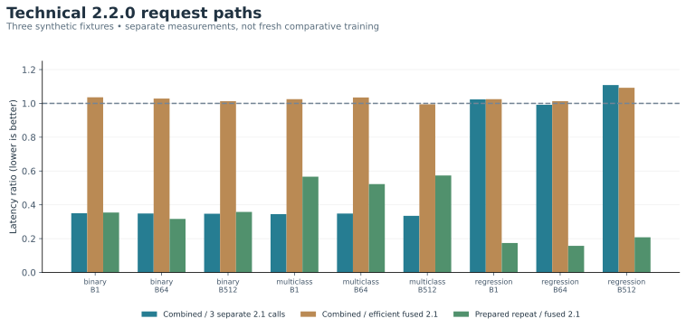
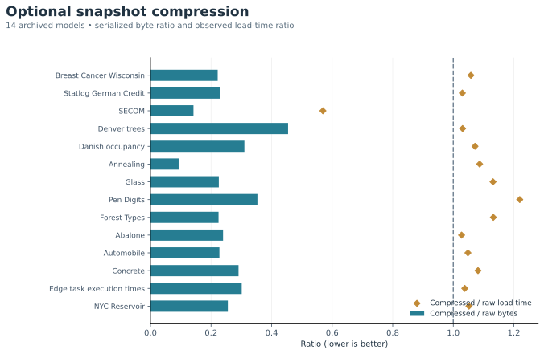
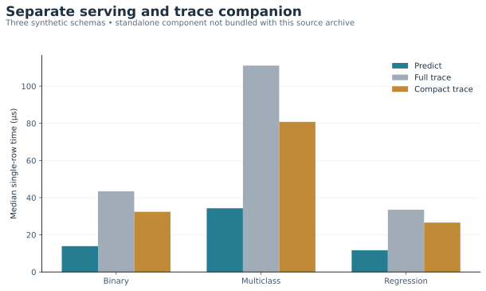

# Technical performance: 2.2.0 versus 2.1.0

These are separate existing implementation measurements, not new competitive results. The combined path avoids redundant classifier calls; an efficient fused baseline is the meaningful stronger reference. Setup is excluded from repeated prepared-input timing.

## Combined requests and prepared inputs

| Task | Batch | Combined / three calls | Combined / fused | Prepared / fused |
| --- | --- | --- | --- | --- |
| binary | 1 | 0.35002 | 1.03594 | 0.35422 |
| binary | 64 | 0.34841 | 1.02868 | 0.31638 |
| binary | 512 | 0.34723 | 1.01324 | 0.35791 |
| multiclass | 1 | 0.34477 | 1.02507 | 0.56621 |
| multiclass | 64 | 0.34827 | 1.03490 | 0.52243 |
| multiclass | 512 | 0.33455 | 0.99478 | 0.57331 |
| regression | 1 | 1.02364 | 1.02511 | 0.17402 |
| regression | 64 | 0.99196 | 1.01335 | 0.15715 |
| regression | 512 | 1.10854 | 1.09257 | 0.20764 |

## Optional snapshot compression

| Dataset | Raw bytes | Compressed bytes | Byte ratio | Load ratio |
| --- | --- | --- | --- | --- |
| Breast Cancer Wisconsin | 40243 | 8933 | 0.22198 | 1.05811 |
| Statlog German Credit | 19759 | 4556 | 0.23058 | 1.02993 |
| SECOM | 289118 | 41055 | 0.14200 | 0.56945 |
| Denver trees | 6569 | 2985 | 0.45441 | 1.03074 |
| Danish occupancy | 36014 | 11171 | 0.31018 | 1.07171 |
| Annealing | 143687 | 13366 | 0.09302 | 1.08704 |
| Glass | 107919 | 24360 | 0.22572 | 1.13126 |
| Pen Digits | 267929 | 94639 | 0.35322 | 1.21954 |
| Forest Types | 124246 | 27931 | 0.22480 | 1.13231 |
| Abalone | 22934 | 5498 | 0.23973 | 1.02737 |
| Automobile | 30574 | 6962 | 0.22771 | 1.04836 |
| Concrete | 36455 | 10601 | 0.29080 | 1.08165 |
| Edge task execution times | 10178 | 3067 | 0.30134 | 1.03797 |
| NYC Reservoir | 45325 | 11583 | 0.25555 | 1.05179 |

Compression changes serialized bytes, not necessarily loaded RAM. Load can increase; these are archived model observations.

## Prepared session cost

The printed source tables display 56 rows (14 origins × four batch sizes), although the caption says 42. The data below retain all 56 printed rows. This is a transcription discrepancy, not a new qualification claim.

| Dataset | Batch | Setup (ms) | Break-even calls | Input bytes | Model arrays bytes | Traced peak (KiB) | Process + session (MiB) |
| --- | --- | --- | --- | --- | --- | --- | --- |
| Breast Cancer Wisconsin | 1 | 1.0768 | 10 | 3206 | 31225 | 455.39 | 155.66 |
| Breast Cancer Wisconsin | 64 | 1.0768 | 10 | 3206 | 31225 | 455.39 | 155.66 |
| Breast Cancer Wisconsin | 512 | 1.0768 | 7 | 3206 | 31225 | 455.39 | 155.66 |
| Breast Cancer Wisconsin | 3000 | 1.0768 | 4 | 3206 | 31225 | 455.39 | 155.66 |
| Statlog German Credit | 1 | 6.8499 | 2 | 10808 | 8932 | 304.83 | 156.43 |
| Statlog German Credit | 64 | 6.8499 | 2 | 10808 | 8932 | 304.83 | 156.43 |
| Statlog German Credit | 512 | 6.8499 | 2 | 10808 | 8932 | 304.83 | 156.43 |
| Statlog German Credit | 3000 | 6.8499 | 1 | 10808 | 8932 | 304.83 | 156.43 |
| SECOM | 1 | 26.0427 | 9 | 329348 | 130077 | 5221.51 | 167.34 |
| SECOM | 64 | 26.0427 | 7 | 329348 | 130077 | 5221.51 | 167.34 |
| SECOM | 512 | 26.0427 | 4 | 329348 | 130077 | 5221.51 | 167.34 |
| SECOM | 3000 | 26.0427 | 2 | 329348 | 130077 | 5221.51 | 167.34 |
| Denver trees | 1 | 3.7375 | 3 | 27104 | 742 | 343.01 | 185.67 |
| Denver trees | 64 | 3.7375 | 3 | 27104 | 742 | 343.01 | 185.67 |
| Denver trees | 512 | 3.7375 | 3 | 27104 | 742 | 343.01 | 185.67 |
| Denver trees | 3000 | 3.7375 | 2 | 27104 | 742 | 343.01 | 185.67 |
| Danish occupancy | 1 | 1.9091 | 3 | 15488 | 27650 | 275.12 | 172.18 |
| Danish occupancy | 64 | 1.9091 | 3 | 15488 | 27650 | 275.12 | 172.18 |
| Danish occupancy | 512 | 1.9091 | 3 | 15488 | 27650 | 275.12 | 172.18 |
| Danish occupancy | 3000 | 1.9091 | 2 | 15488 | 27650 | 275.12 | 172.18 |
| Annealing | 1 | 18.8763 | 2 | 16316 | 1660 | 664.70 | 172.48 |
| Annealing | 64 | 18.8763 | 2 | 16316 | 1660 | 664.70 | 172.48 |
| Annealing | 512 | 18.8763 | 2 | 16316 | 1660 | 664.70 | 172.48 |
| Annealing | 3000 | 18.8763 | 1 | 16316 | 1660 | 664.70 | 172.48 |
| Glass | 1 | 3.3022 | 27 | 1154 | 1997 | 360.24 | 173.62 |
| Glass | 64 | 3.3022 | 25 | 1154 | 1997 | 360.24 | 173.62 |
| Glass | 512 | 3.3022 | 20 | 1154 | 1997 | 360.24 | 173.62 |
| Glass | 3000 | 3.3022 | 12 | 1154 | 1997 | 360.24 | 173.62 |
| Pen Digits | 1 | 7.6637 | 49 | 64064 | 4022 | 995.87 | 173.83 |
| Pen Digits | 64 | 7.6637 | 47 | 64064 | 4022 | 995.87 | 173.83 |
| Pen Digits | 512 | 7.6637 | 19 | 64064 | 4022 | 995.87 | 173.83 |
| Pen Digits | 3000 | 7.6637 | 6 | 64064 | 4022 | 995.87 | 173.83 |
| Forest Types | 1 | 3.4371 | 28 | 1082 | 2226 | 396.87 | 174.14 |
| Forest Types | 64 | 3.4371 | 32 | 1082 | 2226 | 396.87 | 174.14 |
| Forest Types | 512 | 3.4371 | 20 | 1082 | 2226 | 396.87 | 174.14 |
| Forest Types | 3000 | 3.4371 | 8 | 1082 | 2226 | 396.87 | 174.14 |
| Abalone | 1 | 2.0599 | 3 | 17952 | 15266 | 230.37 | 174.70 |
| Abalone | 64 | 2.0599 | 3 | 17952 | 15266 | 230.37 | 174.70 |
| Abalone | 512 | 2.0599 | 3 | 17952 | 15266 | 230.37 | 174.70 |
| Abalone | 3000 | 2.0599 | 2 | 17952 | 15266 | 230.37 | 174.70 |
| Automobile | 1 | 5.2988 | 2 | 2720 | 17944 | 349.82 | 174.70 |
| Automobile | 64 | 5.2988 | 2 | 2720 | 17944 | 349.82 | 174.70 |
| Automobile | 512 | 5.2988 | 2 | 2720 | 17944 | 349.82 | 174.70 |
| Automobile | 3000 | 5.2988 | 1 | 2720 | 17944 | 349.82 | 174.70 |
| Concrete | 1 | 1.0016 | 10 | 4464 | 27982 | 261.88 | 174.70 |
| Concrete | 64 | 1.0016 | 10 | 4464 | 27982 | 261.88 | 174.70 |
| Concrete | 512 | 1.0016 | 8 | 4464 | 27982 | 261.88 | 174.70 |
| Concrete | 3000 | 1.0016 | 4 | 4464 | 27982 | 261.88 | 174.70 |
| Edge task execution times | 1 | 1.2862 | 3 | 3140 | 4958 | 102.06 | 174.91 |
| Edge task execution times | 64 | 1.2862 | 3 | 3140 | 4958 | 102.06 | 174.91 |
| Edge task execution times | 512 | 1.2862 | 2 | 3140 | 4958 | 102.06 | 174.91 |
| Edge task execution times | 3000 | 1.2862 | 2 | 3140 | 4958 | 102.06 | 174.91 |
| NYC Reservoir | 1 | 1.5915 | 3 | 2144 | 37092 | 270.68 | 174.98 |
| NYC Reservoir | 64 | 1.5915 | 3 | 2144 | 37092 | 270.68 | 174.98 |
| NYC Reservoir | 512 | 1.5915 | 2 | 2144 | 37092 | 270.68 | 174.98 |
| NYC Reservoir | 3000 | 1.5915 | 1 | 2144 | 37092 | 270.68 | 174.98 |

## Separate lightweight serving and trace

The standalone stdlib companion is **not included** in the distributions. The measurements are from a separate three-schema, 153-probe validation; they are not comparisons against other serving implementations.

| Task | State bytes | Loaded RSS (MiB) | Peak RSS (MiB) | Predict (μs) | Full trace (μs) | Compact trace (μs) |
| --- | --- | --- | --- | --- | --- | --- |
| binary | 5972 | 18.973 | 20.137 | 13.90 | 43.40 | 32.40 |
| multiclass | 13668 | 20.047 | 22.391 | 34.30 | 111.10 | 80.80 |
| regression | 1768 | 21.281 | 22.391 | 11.70 | 33.50 | 26.60 |

| Task | Batch | Predict (μs) | Full trace (μs) | Compact trace (μs) | Predict rows/s | Full trace rows/s | Compact trace rows/s |
| --- | --- | --- | --- | --- | --- | --- | --- |
| binary | 1 | 13.90 | 43.40 | 32.40 | 71942 | 23041 | 30864 |
| binary | 32 | 407.90 | 1341.30 | 986.80 | 78451 | 23857 | 32428 |
| binary | 256 | 3411.40 | 10988.90 | 8007.60 | 75043 | 23296 | 31970 |
| multiclass | 1 | 34.30 | 111.10 | 80.80 | 29155 | 9001 | 12376 |
| multiclass | 32 | 1119.10 | 3716.50 | 2670.50 | 28594 | 8610 | 11983 |
| multiclass | 256 | 9278.30 | 30382.50 | 21741.70 | 27591 | 8426 | 11775 |
| regression | 1 | 11.70 | 33.50 | 26.60 | 85470 | 29851 | 37594 |
| regression | 32 | 304.10 | 977.70 | 774.40 | 105229 | 32730 | 41322 |
| regression | 256 | 3718.80 | 12582.80 | 8748.50 | 68839 | 20345 | 29262 |

Trace reconstructs computation, not causal attribution or SHAP values. Probability agreement is within 2e-15 for the companion; score and class are exact in the recorded contracts.
